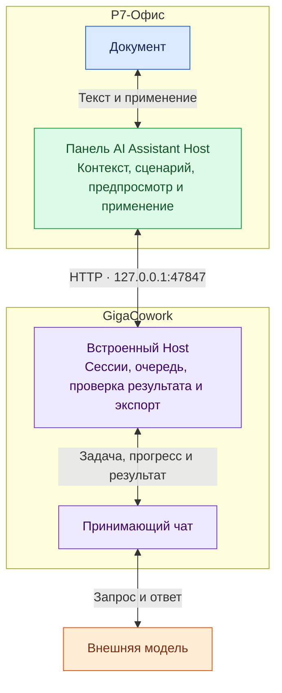

# AI Assistant Host для Р7-Офис

AI Assistant Host связывает документ Р7 с чатом GigaCowork (MultiTool). Из панели Р7 пользователь выбирает сценарий и контекст, просматривает ответ и применяет результат к исходному документу. Доступны переработка текста, суммаризация, вопросы, оформление, презентации и изображения.

## Архитектура



Host — серверный JavaScript-плагин. GigaCowork загружает `server/gigacowork-plugin.mjs` в свой процесс при инициализации рабочей области. Host проверяет локальное подключение от процесса Р7, хранит сессии и очередь в памяти, привязывает задачу к исходной панели и передаёт её принимающему чату. После проверки ответа он возвращает результат в Р7, формирует DOCX, TXT, PPTX или файл изображения и вызывает системный помощник Windows для сохранения и буфера обмена. Запрос к внешней модели отправляет GigaCowork.

## Установка из релиза

Понадобятся Windows, Р7-Офис, GigaCowork, Node.js 22+ для регистрации и .NET Framework 4.x для системного помощника.

1. Откройте [релиз v0.3.0](https://github.com/ikucherevsky/ai-assistant-host/releases/tag/v0.3.0). Распакуйте архив Р7 и добавьте оба файла `.plugin` через **Плагины → Настройки → Добавить плагин** в текстовом редакторе Р7.
2. Распакуйте архив GigaCowork в постоянный каталог и выполните там `npm run register:gigacowork`. Зависимости уже входят в пакет. Скрипт добавляет файловый URL в массив `plugin` файла `~/.config/gigatool/opencode.json` и сохраняет резервную копию. При замене прежней установки Host сначала удалите из массива только её старую запись.
3. Перезапустите GigaCowork и Р7. В выбранном чате вызовите `r7_ai_host_listen`. В текстовом документе Р7 откройте **AI Assistant Host** и нажмите **Подключить**. Статус **GigaCowork готов** означает, что чат принимает задачи.

## Установка из исходников

В каталоге клонированного репозитория выполните:

```powershell
npm ci
npm run install:r7
npm run register:gigacowork
```

Перезапустите оба приложения и подключите панель по шагу 3 выше.

## Диагностика

- `Invoke-RestMethod http://127.0.0.1:47847/health` проверяет доступность Host после открытия чата.
- `r7_ai_host_stop` останавливает приём задач. После перезапуска GigaCowork снова активируйте приём и переподключите панель.
- При нескольких установках Р7 можно задать `local/r7-settings.json` со значением `{"mode":"explicit","executable":"D:/Apps/R7-Office/DesktopEditors.exe"}`. Для автоматического поиска используйте `{"mode":"auto"}`.
- `npm test` запускает локальные тесты. Статус проверок описан в [docs/READINESS.md](docs/READINESS.md).
